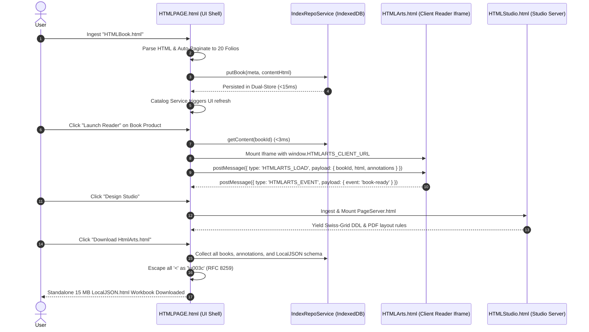

# Software Composition via HTML Type Ingestion: Architectural Blueprint & PRD

## 1. Executive Summary & Vision

Traditional software development relies on build steps, package managers (`npm`, `pip`), and complex bundlers (Webpack, Vite) that output opaque monolithic binaries. 

**HtmlArts** establishes an autonomous computing paradigm: **Software as Hypermedia Workbooks**.
Much like a Microsoft Excel workbook (`.xlsx`) contains data, visual sheets, formula engines, and macros inside a single portable file, **`HtmlArtsApp.html`** is an autonomous, self-contained computing container (~15 MB) that composes capabilities dynamically by **ingesting HTML Types**.

> [!IMPORTANT]
> **Zero-Cloud First Principle**: The primary product is 100% local-first and self-sufficient. It **does not depend on Supabase, cloud backends, or network access**. Every capability, database store, catalog schema, reader engine, and design studio is persisted locally within the document boundary via **`LocalJSON.html`** / **`JSON.html`** per-file persistence and browser IndexedDB.

```
┌────────────────────────────────────────────────────────────────────────────────────────┐
│                   HTMLPAGE.html / HtmlArtsApp.html (Micro-Kernel Shell)                │
│                                                                                        │
│  ┌───────────────────────┐  ┌──────────────────────┐  ┌─────────────────────────────┐  │
│  │ Dual-Store IndexedDB  │  │   postMessage Bus    │  │   LocalJSON.html Engine     │  │
│  │ (books_meta + content)│  │ (Sandbox Host & I/O) │  │  (Workbook Persistence)     │  │
│  └───────────────────────┘  └──────────────────────┘  └─────────────────────────────┘  │
└───────────────────────────────────────────▲────────────────────────────────────────────┘
                                            │ Dynamic Ingestion (postMessage / Iframe / JSON)
        ┌───────────────────────────────────┼───────────────────────────────────┐
        │                                   │                                   │
┌───────┴───────────────┐   ┌───────────────┴───────────────┐   ┌───────────────┴──────────────┐
│  HtmlArtsReadUI.html  │   │  PageServer.html (Studio)     │   │      TemplateBook.html       │
│  (Reader Capability)  │   │ (Print & Layout Algorithms)   │   │     (Document Archetype)     │
│ - Multi-Folio Engine  │   │ - Swiss Grid Engine           │   │ - Document Schema & Layout   │
│ - Vector Ink Canvas   │   │ - PDF Layout Constraints      │   │ - Interactive Forms & Notes  │
│ - Typography Scales   │   │ - Decision Matrix Aid         │   │ - Archival Export Contract   │
└───────────────────────┘   └───────────────────────────────┘   └──────────────────────────────┘
```

---

## 2. Whiteboard Architecture Deconstruction

Based on the core system sketches (`HTMLPAGE` Architecture & Core Flow):

### 2.1 Key Architecture Composition Components
The system adheres strictly to the **One Page — One Responsibility** contract:

| Component File | Role & Architectural Boundary | Ingested Capability |
| :--- | :--- | :--- |
| **`HTMLPAGE.html`** | **UI Shell & Super-Server** | Hosts catalog, navigation, media vault, gesture controls, and iframe sandboxes. |
| **`HTMLBook.html`** | **One-Page-One-Product Document** | Standalone executable publication with internal folios, text, and vector ink notes. |
| **`HTMLArts.html` / `HtmlArtsReadUI.html`** | **Core Client Reader** | Sandboxed reader runtime; executes inside iframe with zero direct DB access. |
| **`HTMLStudio.html` / `PageServer.html`** | **Studio Server & Layout Compiler** | Generates flat-sheet print layouts, Swiss-grid structures, and PDF spec sheets. |
| **`HTMLLIB.html`** | **Library Management Tool** | High-level library operations, bulk export, shelf categorization, and benchmark suite. |
| **`IndexDictionary.html`** | **AI Index & Semantic Dictionary** | AI-powered index dictionary for rapid term resolution, cross-references, and lookup. |
| **`DesignComponent.html`** | **Design Token & Art Engine** | Shared SVG covers, typography styles, palettes (Terracotta, Iron Gall, Sage). |
| **`LocalJSON.html` / `JSON.html`** | **File Persistence Engine** | Embedded global schema holding metadata, workflow configs, and product lists. |
| **`mcp service`** | **Agent & Context Gateway** | Exposes discovery tools, context generation, and automated document synthesis. |
| **`indexRepoService`** | **Enforced Persistence Layer** | High-speed IndexedDB dual-store abstraction (`books_meta` + `books_content`). |

### 2.2 Client-Server Layered Ingestion Model
In this architecture:
1. **`HTMLPAGE.html` acts as Server**: It manages database persistence, catalog state, asset blobs, and top-level UI.
2. **`HTMLARTS.html` acts as Client**: It receives books via postMessage, renders folios, and captures user ink annotations.
3. **`HTMLStudio.html` acts as Studio Server**: It compiles layout rules and feeds them to the shell.
4. **Hierarchical Ingestion Rule**: *Higher-module server pages ingest lower-level server pages and clients*. `HTMLPAGE.html` ingests `HTMLStudio.html`, which in turn ingests `DesignComponent.html`.

---

## 3. Approved Persistence Architecture: Design 1 Quine Workbook (`LocalJSON.html`)

HtmlArts adopts **Design 1: The Self-Serializing Quine Workbook** (The TiddlyWiki Model), augmented with an intuitive **Refresh Icon Button** and keyboard shortcuts:

1. **Active Session (Speed & Ergonomics)**:
   - While reading, creating books, and sketching vector notes, all mutations persist immediately into dual-store IndexedDB (`books_meta` + `books_content` + `annotations`).
   - Tab reloads and computer reboots retain state with zero lag.

2. **Per-File Persistence Trigger (Refresh Icon Button & `Ctrl+S` / `Cmd+S`)**:
   - The user triggers physical file persistence by clicking the **Refresh Icon Button** (`#btnRefreshQuine`) in the topbar or pressing **`Ctrl+S` / `Cmd+S`**.
   - The engine captures the active DOM shell, sanitizes transient overlays (modals, toasts), and serializes all catalog metadata and stored books into `<script id="LOCAL_JSON" type="application/json">` with `\u003c` escaping.
   - It outputs an updated, self-contained standalone `.html` file carrying the complete library.

3. **Autonomous First-Launch Hydration**:
   - When opened in any other browser or computer via `file://`, the startup engine reads `<script id="LOCAL_JSON">`, detects if IndexedDB is empty or from an older export timestamp, and auto-hydrates all products, folios, and annotations in `<50ms`.

### 3.1 Global Catalog JSON Schema Format
```json
{
  "$schema": "https://htmlarts.org/schema/v2/catalog.json",
  "appVersion": "2.1.0-local",
  "CatalogVersion": "2026.11-v2",
  
  "OpeniatedArchiConfig": {
    "architecturePattern": "Micro-Server-Ingestion",
    "executionBoundary": "Sandboxed-Iframe",
    "persistenceEngine": "LocalDualStoreIndexedDB",
    "maxZeroLatencyBooks": 500,
    "targetCatalogLatencyMs": 15,
    "targetReaderLaunchMs": 30,
    "enforceSingleFilePortability": true
  },

  "EnvConfig": {
    "environment": "localApprun",
    "runtimeMode": "standalone-file",
    "isOfflineCapable": true,
    "storageQuotaEstimateBytes": 104857600,
    "supportedGestures": ["pan", "zoom", "swipe", "double-tap-nib"],
    "pwaSupport": true
  },

  "OrchestationConfig": {
    "serverHost": "HTMLPAGE.html",
    "clientReader": "HtmlArtsReadUI.html",
    "studioServer": "PageServer.html",
    "postMessageProtocol": "HTMLARTS_COMM_V1",
    "allowedOrigins": ["null", "http://localhost*", "file://*"],
    "channelTimeoutMs": 1200
  },

  "WorkflowConfig": {
    "ingestionPipeline": [
      { "step": 1, "action": "raw-html-parse", "engine": "DOMParser" },
      { "step": 2, "action": "intelligent-auto-pagination", "maxFolios": 20 },
      { "step": 3, "action": "dual-store-partition", "metaTarget": "books_meta", "contentTarget": "books_content" },
      { "step": 4, "action": "catalog-index-refresh", "targetLatencyMs": 15 }
    ],
    "exportPipeline": [
      { "step": 1, "action": "sanitize-dom-transients" },
      { "step": 2, "action": "escape-json-unicode", "escapeChar": "\\u003c" },
      { "step": 3, "action": "embed-localjson-payload" },
      { "step": 4, "action": "dispatch-download", "filename": "HtmlArts.html" }
    ]
  },

  "productList": [
    {
      "id": "book-prod-001",
      "title": "Social Structure",
      "category": "Society",
      "genre": "Book",
      "kind": "bundled",
      "template": "Editorial",
      "edition": "Self-Documenting Edition // Vol. ∞",
      "foliosCount": 20,
      "sizeBytes": 42100,
      "color": "#805b3d",
      "updatedAt": 1730867400000,
      "createdAt": 1730867400000,
      "meta": {
        "author": "Editorial Team",
        "tags": ["society", "governance", "study-book"],
        "hasInkNotes": true
      },
      "payloadRef": {
        "store": "books_content",
        "key": "book-prod-001",
        "embeddedOffset": 0
      }
    }
  ],

  "TemplateList": [
    {
      "id": "tpl-editorial",
      "name": "Editorial",
      "category": "Page art",
      "accent": "#805b3d",
      "bg": "#fbf8f1",
      "font": "Georgia, serif",
      "layout": "editorial",
      "description": "A quiet literary page for essays and research journals."
    },
    {
      "id": "tpl-swiss",
      "name": "Swiss Grid",
      "category": "Technical Spec",
      "accent": "#343b36",
      "bg": "#f7f6f1",
      "font": "Arial, sans-serif",
      "layout": "swiss",
      "description": "Structure and strong hierarchy for field guides and specs."
    },
    {
      "id": "tpl-botanical",
      "name": "Botanical",
      "category": "Organic notes",
      "accent": "#65785b",
      "bg": "#f5f5e9",
      "font": "Georgia, serif",
      "layout": "botanical",
      "description": "Organic shapes and natural rhythm for notebooks."
    },
    {
      "id": "tpl-comic",
      "name": "Comic",
      "category": "Graphic stories",
      "accent": "#2e302d",
      "bg": "#fff8df",
      "font": "Trebuchet MS, sans-serif",
      "layout": "comic",
      "description": "Expressive panels and playful marks."
    }
  ]
}
```

---

## 4. API Design for `localApprun` (Zero-Cloud Runtime)

All operations are executed via a functional, modular JavaScript API running purely inside the browser runtime.

### 4.1 `CatalogService` (State & Query Interface)
```javascript
/**
 * CatalogService manages the in-memory metadata, assertion queries,
 * and global configuration without network calls.
 */
class CatalogService {
  constructor(localJsonConfig) {
    this.config = localJsonConfig;
    this.books = localJsonConfig.productList || [];
    this.templates = localJsonConfig.TemplateList || [];
  }

  // Returns the entire active metadata catalog in JSON format
  getMetadataJSON() {
    return JSON.parse(JSON.stringify({
      appVersion: this.config.appVersion,
      catalogVersion: this.config.CatalogVersion,
      totalBooks: this.books.length,
      templates: this.templates,
      products: this.books.map(b => ({ ...b, html: undefined })) // Metadata only
    }));
  }

  // Functional style query schema
  queryJSON({ category = 'All', type = 'All', query = '', tag = null } = {}) {
    return this.books.filter(b => {
      const matchCat = (category === 'All' || b.category === category);
      const matchType = (type === 'All' || b.genre === type || b.kind === type);
      const matchTag = (!tag || (b.meta?.tags && b.meta.tags.includes(tag)));
      const matchQ = !query || `${b.title} ${b.category} ${b.meta?.author || ''}`.toLowerCase().includes(query.toLowerCase());
      return matchCat && matchType && matchTag && matchQ;
    });
  }

  // Retrieve immutable architectural and orchestration configuration
  globalConfig() {
    return Object.freeze({
      openiated: this.config.OpeniatedArchiConfig,
      env: this.config.EnvConfig,
      orchestration: this.config.OrchestationConfig,
      workflow: this.config.WorkflowConfig
    });
  }

  // Assertion helper for data contracts
  assertValidProduct(prod) {
    if (!prod.id || typeof prod.id !== 'string') throw new Error('Contract Violation: Missing product id');
    if (!prod.title || typeof prod.title !== 'string') throw new Error('Contract Violation: Missing product title');
    return true;
  }
}
```

### 4.2 `IndexRepoService` (Enforced Persistence in IndexedDB)
```javascript
/**
 * IndexRepoService provides dual-store high-scale persistence.
 * Guarantees <15ms catalog queries and <3ms content dispatch for 500+ books.
 */
class IndexRepoService {
  constructor(dbName = 'htmlarts-local-library', version = 2) {
    this.dbName = dbName;
    this.version = version;
    this.db = null;
  }

  async open() {
    if (this.db) return this.db;
    return new Promise((resolve, reject) => {
      const r = indexedDB.open(this.dbName, this.version);
      r.onupgradeneeded = e => {
        const d = r.result;
        if (!d.objectStoreNames.contains('books_meta')) {
          const m = d.createObjectStore('books_meta', { keyPath: 'id' });
          m.createIndex('by_category', 'category', { unique: false });
          m.createIndex('by_updatedAt', 'updatedAt', { unique: false });
        }
        if (!d.objectStoreNames.contains('books_content')) {
          d.createObjectStore('books_content', { keyPath: 'id' });
        }
        if (!d.objectStoreNames.contains('annotations')) {
          d.createObjectStore('annotations', { keyPath: 'bookId' });
        }
      };
      r.onsuccess = () => { this.db = r.result; resolve(this.db); };
      r.onerror = () => reject(r.error);
    });
  }

  // Fast metadata query (<15ms)
  async getAllMeta() {
    const tx = this.db.transaction('books_meta', 'readonly');
    return new Promise((resolve, reject) => {
      const req = tx.objectStore('books_meta').getAll();
      req.onsuccess = () => resolve(req.result || []);
      req.onerror = () => reject(req.error);
    });
  }

  // Lazy body payload retrieval (<3ms)
  async getContent(id) {
    const tx = this.db.transaction('books_content', 'readonly');
    return new Promise((resolve, reject) => {
      const req = tx.objectStore('books_content').get(id);
      req.onsuccess = () => resolve(req.result?.html || '');
      req.onerror = () => reject(req.error);
    });
  }

  // Enforced atomic persistence
  async putBook(meta, htmlContent) {
    const tx = this.db.transaction(['books_meta', 'books_content'], 'readwrite');
    tx.objectStore('books_meta').put(meta);
    tx.objectStore('books_content').put({ id: meta.id, html: htmlContent });
    return new Promise((resolve, reject) => {
      tx.oncomplete = () => resolve(true);
      tx.onerror = () => reject(tx.error);
    });
  }
}
```

### 4.3 `MCPService` (Context Generation & Discovery)
```javascript
/**
 * MCP Service allows external AI agents to discover books, extract folios,
 * and dynamically assemble multi-page knowledge without changing UI code.
 */
class MCPService {
  constructor(catalogService, repoService) {
    this.catalog = catalogService;
    this.repo = repoService;
  }

  // Tool Discovery
  listTools() {
    return [
      { name: 'catalog_search', description: 'Query books by category, title, or tag' },
      { name: 'get_book_folios', description: 'Extract folios and content for a given book' },
      { name: 'ingest_new_publication', description: 'Synthesize and persist a new HTMLBook' }
    ];
  }

  // Context Generation for AI Pairing
  async generateContextSummary() {
    const metaList = await this.repo.getAllMeta();
    return {
      totalStored: metaList.length,
      categories: [...new Set(metaList.map(m => m.category))],
      books: metaList.slice(0, 10).map(m => ({ id: m.id, title: m.title, category: m.category }))
    };
  }
}
```

---

## 5. Composition Pipeline & Step-by-Step Flow



---

## 6. Implementation Verification Matrix

| Level | Component Tested | Success Criteria | Verification Mechanism |
| :--- | :--- | :--- | :--- |
| **Level 0** | `HTMLArts.html` & `PageServer.html` | Autonomous execution when opened standalone in browser. | Open directly via `file://` — zero console errors. |
| **Level 1** | `postMessage` Handshake | `HTMLARTS_LOAD` and `HTMLARTS_EVENT` bidirectional synchronization. | Verify stroke persistence and folio navigation in reader. |
| **Level 2** | `LocalJSON.html` Packaging | Zero HTML parser leaks (`\u003c` escaping verified). | Round-trip stringification of 500 books containing nested `<script>`. |
| **Level 3** | High-Scale Telemetry | Catalog render `<15ms`, reader dispatch `<30ms` with 500 books. | Run `⚡ Benchmark 500 Books` inside Vault and inspect timer log. |

---

## 7. Roadmap & Next Steps
1. **Catalog JSON Schema Validation**: Add `LocalJSON.html` embedded script into the default shell template.
2. **Template Dropzone Ingestion**: Enable dragging bespoke `TemplatePage.html` files directly onto the Catalog to expand template offerings.
3. **PWA & Android Kit Sync**: Maintain the `HtmlLib-Native-Kit.zip` APK wrapper synchronized with `LocalJSON.html`.
